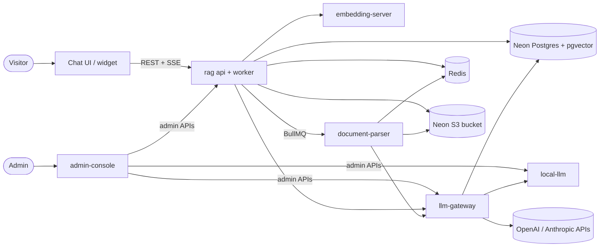
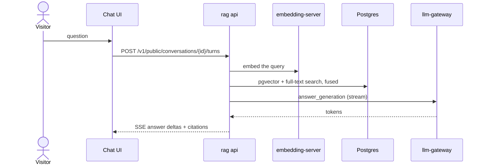
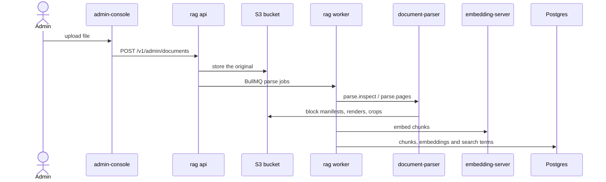

# Universal Chatbot

A RAG platform for answering questions about your own documents. Admins upload PDFs and images;
visitors ask questions in a chat page or an embeddable widget and get streamed answers that cite
the document pages they came from.



## Request flows

**Visitor chat:** the answer is grounded in retrieved chunks and streamed back with citations.



**Admin document upload:** parsing and indexing run in the background.



## Services

| Service | Stack | Role | Port |
| --- | --- | --- | --- |
| [rag](services/rag/README.md) | TypeScript, NestJS, Drizzle | Ingestion pipeline, hybrid retrieval, chat API, admin API | 8080 (api), 8081 (worker) |
| [document-parser](services/document-parser/README.md) | Python, BullMQ, pypdfium2, Tesseract | Turns PDFs and images into content blocks | 8090 |
| [embedding-server](services/embedding-server/README.md) | Python, FastAPI, PyTorch | EmbeddingGemma 2 vectors with dynamic batching | 8000 |
| [llm-gateway](services/llm-gateway/README.md) | Python, FastAPI, SQLAlchemy, Alembic | Routes each task to a chain of models, with fallbacks and caching | 4000 |
| [local-llm](services/local-llm/README.md) | Python, Transformers, llama.cpp | Optional self-hosted models on CPU or NVIDIA GPU | 8095 |
| [admin-console](services/admin-console/README.md) | TypeScript, Fastify, React | The one admin UI | 3100 |
| [frontend-chat-interface](services/frontend-chat-interface/README.md) | TypeScript, React, Vite | Full-page public chat | 3000 |
| [chat-widget](services/chat-widget/README.md) | TypeScript, Web Components | `<universal-chat-bot>` embeddable widget | — |

Data stores: PostgreSQL with pgvector (it holds the search index too) and an S3-compatible bucket
are external (Neon provides both); Redis 8 runs in the stack. Every service reads them through
connection strings only.

## Quick start

Needs Docker with Compose v2.20+ and `make`.

```bash
cp platform.env.example platform.env   # Neon URLs, bucket keys, and every change_this value
make up
```

EmbeddingGemma is a gated model: accept its licence on Hugging Face, then put a read token in
`services/embedding-server/.env` as `EMBEDDING_SERVER_HUGGINGFACE_TOKEN`.

| UI | URL |
| --- | --- |
| Admin console | http://localhost:3100 |
| Chat | http://localhost:3000 |
| RAG API docs | http://localhost:8080/docs (with `RAG_ENABLE_API_DOCS=true`) |

`make logs` follows every container, `make ps` shows their state and `make down` stops the
stack (data volumes are kept). On NVIDIA hosts, `make up-gpu` runs the model servers on the GPU.

## Deploying to Hugging Face

Every push to `main` runs every service's tests, builds one image with all services
([deploy/huggingface-space](deploy/huggingface-space/README.md)) and publishes it to the Space named
by the `HF_SPACE` repository variable. Secrets live in the repository's GitHub secrets and are
copied to the Space on each deploy.

## Development

`make test` lints, typechecks and tests the TypeScript services. Each service has its own README
with its commands and a `docker-compose.yml` to run it on its own.

## Documentation

- [Architecture](docs/architecture.md): containers, ingestion and question-answering flows, deployment options
- [Hugging Face Space](deploy/huggingface-space/README.md): the one-container image, its secrets and routes
