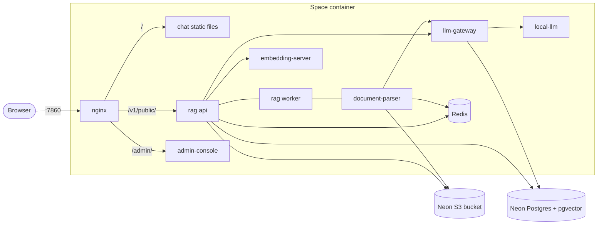

# Hugging Face Space

The whole platform in one container, for a free CPU Docker Space (2 vCPU, 16 GB RAM, one public
port). The services are unchanged: `docker-bake.hcl` builds each one from its own Dockerfile and
this folder's `Dockerfile` copies the results into one image, with supervisord in place of Compose.



A Space's disk is wiped on every restart, so everything that must survive lives outside it:
Postgres (rag and llm-gateway share one database, which also holds the search index) and the
object store. Redis only holds the queue of uploads in progress. Keys the services use to call each other are generated on each
boot and never leave the container.

## Secrets

Set these as GitHub repository secrets; GitHub is their only source. Every deploy writes all of them
to the Space (`sync_space_settings.py`) and fails if one is missing, so never edit them on the Space.

| Secret | Value |
| --- | --- |
| `DATABASE_URL` | Neon connection string. The pooled (`-pooler`) one works too; the direct host is derived from it. |
| `S3_ENDPOINT`, `S3_REGION`, `S3_BUCKET`, `S3_ACCESS_KEY_ID`, `S3_SECRET_ACCESS_KEY` | Any S3-compatible bucket (Neon, R2, B2); it stays private. Use `auto` as `S3_REGION` when the provider has none. |
| `LLM_GATEWAY_ENCRYPTION_KEY` | Encrypts stored provider API keys. `cd services/llm-gateway && python -m app.cli generate-secrets` |
| `RAG_CLIENT_HASH_SECRET` | 32+ random characters. Changing it forgets every chat client. |
| `ADMIN_CONSOLE_ADMIN_PASSWORD_HASH` | `cd services/admin-console && npm run hash-password` |
| `HF_TOKEN` | Hugging Face read token with access to the gated EmbeddingGemma model |

Optional GitHub variables, copied the same way (one unset in GitHub is removed from the Space): `ADMIN_CONSOLE_ADMIN_USERNAME` (default `admin`),
`CHAT_WIDGET_ALLOWED_ORIGINS` (comma-separated sites that embed the widget; defaults to the Space's
own origin) and the chat's `CHAT_RUNTIME_BOT_NAME`, `CHAT_RUNTIME_BRAND_ACCENT`,
`CHAT_RUNTIME_BRAND_LOGO_URL`.

## Deploying

`.github/workflows/huggingface-space.yml` runs on every push to `main`: it runs every service's
tests, pushes the image to `ghcr.io/<owner>/universal-chatbot-space`, then force-pushes a single
commit to the Space with a one-line `Dockerfile` (`FROM <image>@<digest>`). The Space pulls the
image instead of building it, and its history is always that one commit.

One-time setup:

1. Add the `HF_DEPLOY_TOKEN` repository secret (a Hugging Face **write** token, used only by the
   workflow; the Space itself gets the read-only `HF_TOKEN`), and the `HF_SPACE` variable
   (`owner/name`). Until `HF_SPACE` is set the workflow tests and builds but publishes nothing.
2. After the first run, make the `universal-chatbot-space` package public
   (GitHub → Packages → Package settings → Change visibility) so the Space can pull it.

## Building locally

```bash
docker buildx bake -f deploy/huggingface-space/docker-bake.hcl --load                 # from the repository root
docker run --rm -p 7860:7860 --env-file space.env universal-chatbot-space:local
```

`space.env` holds the secrets above. On Apple Silicon, add `--set '*.platform=linux/arm64'` to the
bake command to skip emulation.
