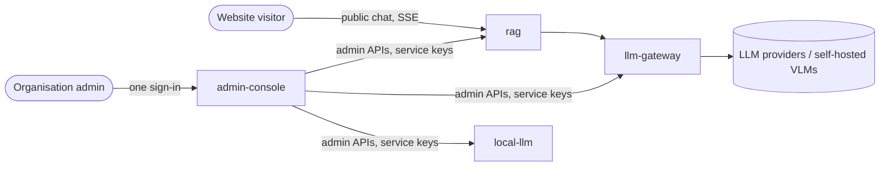
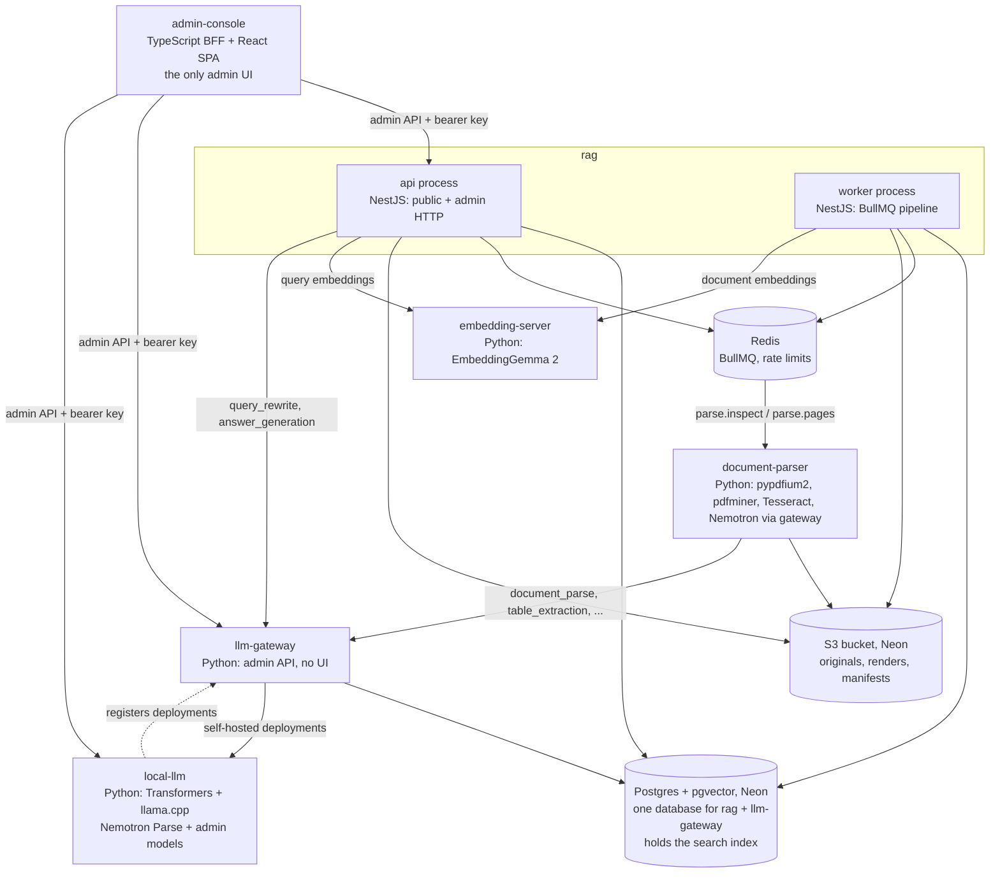
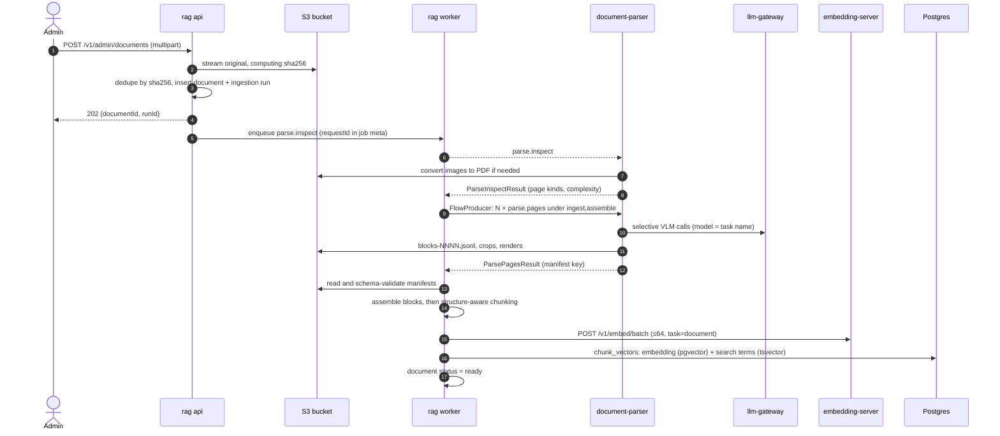
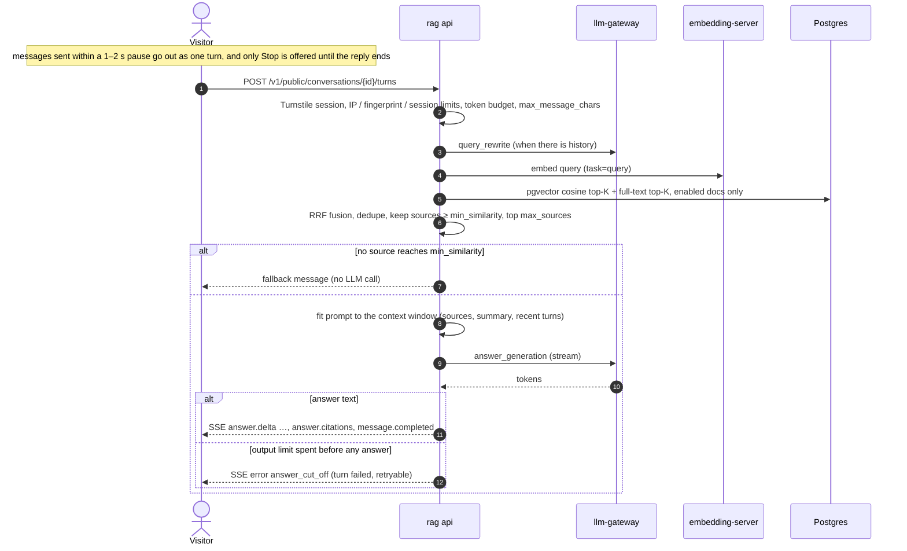

# Architecture

Universal Chatbot is a single-organisation RAG platform. Admins upload documents and run
every service through one admin console; anonymous website visitors ask questions in a public chat
and get streamed, grounded answers that cite document pages.

## System context

## Containers

| Service | Owns |
|---|---|
| embedding-server | Hugging Face model cache |
| llm-gateway | its tables in Postgres (providers, routes, request metrics) |
| admin-console | nothing persistent (in-memory sessions) |
| local-llm | volume `local-llm-state` (deployments, model cache) |
| rag | its tables in Postgres (including chunk vectors), the bucket, Redis `rag:*` |
| document-parser | nothing (writes only under keys it is given) |

## Ingestion

## Question answering

### Prompt budget

The answer prompt is fitted to the smallest context window among the models routed to
`answer_generation` (12,288 tokens when none declares one). The admin's **max answer tokens** are
reserved first; the rules, instruction, sources and new messages come next, and history gets what is
left. History over the summary threshold is folded into a rolling summary by the worker, and the
newest turns are always kept word for word. Whatever the prompt leaves unused is added to the output
limit, up to four times the answer length, because models that think before answering spend output
tokens on it. A turn that ends without answer text is recorded as failed, not as an answer.

## Cross-cutting conventions

- **Configuration:** each service reads only `<SERVICE>_*` environment variables,
  validated at startup. The process refuses to start on any invalid value and names
  every offending variable.
- **Errors:** RFC 9457 `application/problem+json` with a stable `code` and the
  `requestId`.
- **Logs:** JSON lines on stdout (`make logs`); every request has an `X-Request-ID`
  that appears in each log line it causes, including the queue jobs it enqueues.
- **Health:** `/health/live` is the process alone; `/health/ready` checks every
  dependency within a timeout and returns 503 while shutting down.
- **Security:** non-root read-only containers with no Linux capabilities, host ports
  bound to 127.0.0.1, and one admin key per service.
- **Contracts:** queue payloads and manifests are JSON Schemas in
  `services/rag/contracts/`, with generated types and examples validated in CI.

## Deployment

Postgres and the bucket are always external (Neon provides both); every service reads them through
connection strings only. The same service images run in three ways:

| Where | How | Redis |
|---|---|---|
| One machine or VM | root `docker-compose.yml`, one container per service (`make up`) | container in the stack |
| Hugging Face Space | [deploy/huggingface-space](../deploy/huggingface-space/README.md): all services in one container behind nginx, deployed by `.github/workflows/huggingface-space.yml`; GitHub is the only source of its secrets | in the container |
| One service alone | `services/<service>/docker-compose.yml` with its own `.env` | per service |

The service workflows in `.github/workflows/` lint, typecheck and test each service; only the
Space workflow deploys.
