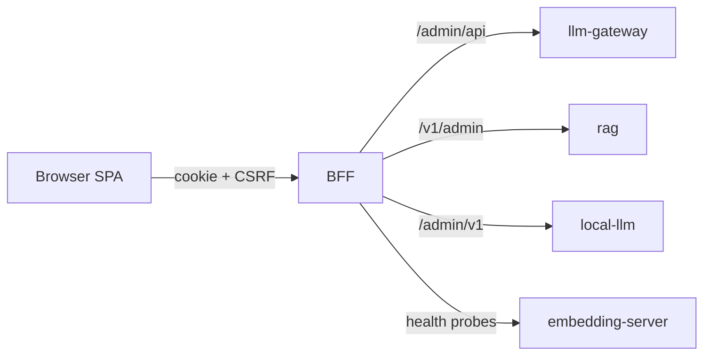

# admin-console

Single admin UI that controls every service of the platform and shows their health.



## Key components

- `server/` — Fastify BFF: sign-in, sessions, proxying
- `src/features/gateway` — routing, chains, providers, analytics
- `src/features/localModels` — model deployments
- `src/features/rag` — documents, settings, conversations
- `src/features/overview`, `src/features/platform` — platform health
- `contracts/` — OpenAPI snapshots for generated types

## Tech stack

- TypeScript, Node.js 24, Fastify
- React 19, Vite, Tailwind CSS v4
- TanStack Query, React Router, Recharts, dnd-kit
- Vitest, Playwright

## Configuration

All variables use the `ADMIN_CONSOLE_` prefix; [.env.example](.env.example) lists every one.

| Variable                                                | Description                             | Default  |
| ------------------------------------------------------- | --------------------------------------- | -------- |
| `ADMIN_CONSOLE_ADMIN_USERNAME` / `_ADMIN_PASSWORD_HASH` | Admin sign-in (`npm run hash-password`) | required |
| `ADMIN_CONSOLE_LLM_GATEWAY_URL` / `_ADMIN_API_KEY`      | Gateway admin API                       | required |
| `ADMIN_CONSOLE_RAG_URL` / `_ADMIN_API_KEY`              | rag admin API                           | required |
| `ADMIN_CONSOLE_LOCAL_LLM_URL` / `_ADMIN_API_KEY`        | local-llm admin API                     | required |
| `ADMIN_CONSOLE_EMBEDDING_SERVER_URL`                    | Embedding server health                 | required |
| `ADMIN_CONSOLE_PORT`                                    | HTTP port                               | `8080`   |
| `ADMIN_CONSOLE_COOKIE_SECURE`                           | Secure session cookie                   | `true`   |

## API

- Session (`/api/session`): sign in, current session, sign out
- Service proxies: `/api/llm-gateway/*`, `/api/rag/*`, `/api/local-llm/*`
- Platform health: `/api/platform/health`
- Health: `/health/live`, `/health/ready`

## Running locally

```bash
npm ci
cp .env.example .env   # point the URLs at running services, set keys and password hash
npm run dev            # BFF on :8086, Vite on http://localhost:5180
```

Checks: `npm run check`; end-to-end: `npm run test:e2e` against the running stack.
