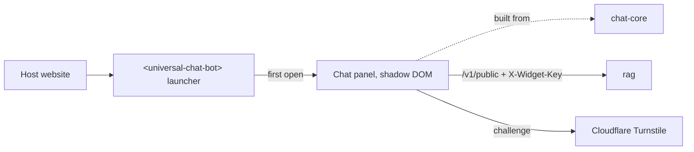

# chat-widget

`<universal-chat-bot>`: an embeddable Web Component that adds the platform's chat assistant to any website.



## Key components

- `src/element` — custom element, liquid-glass launcher (SVG edge refraction in Chromium), settings, mobile page lock
- `src/element/orb` — animated canvas orb
- `src/panel` — lazy-loaded React chat panel
- `src/embed.ts` — script-tag loader
- `build/chatCore.ts` — resolves shared chat-core imports
- `demo/` — plain HTML, React and Vue hosts

## Tech stack

- TypeScript, Web Components, Shadow DOM
- React 19 (panel only), chat-core
- Vite (library build), Vitest, Playwright

## Install

```bash
npm install @faysal1000/universal-chatbot
```

```ts
import '@faysal1000/universal-chatbot';
```

Without a bundler, load it from the CDN instead (see [API](#api)).

## Configuration

Set as attributes on the element. Create the publishable key in the admin console under **RAG → Website widgets**.

| Attribute       | Description                                          | Default        |
| --------------- | ---------------------------------------------------- | -------------- |
| `api-key`       | Publishable key (`pk_…`)                             | required       |
| `api-url`       | rag's public URL                                     | required       |
| `position`      | `top`/`middle`/`bottom` + `-left`/`-center`/`-right` | `bottom-right` |
| `theme`         | `light`, `dark` or `auto`                            | `auto`         |
| `primary-color` | Any CSS colour                                       | `#6d5dfc`      |
| `offset-x`      | Gap to the left/right edge (`24`, `2rem`)            | `20px`         |
| `offset-y`      | Gap to the top/bottom edge (`96`, `6rem`)            | `20px`         |
| `greeting`      | Launcher label                                       | `Chat`         |
| `language`      | `en` or `bn`                                         | page language  |
| `open`          | Present when the panel is open                       | absent         |

## API

- Methods: `open()`, `close()`, `toggle()`, `isOpen`
- Events: `chat-open`, `chat-close`

```html
<script src="https://cdn.jsdelivr.net/npm/@faysal1000/universal-chatbot@0/dist/embed.js" async></script>
<universal-chat-bot api-key="pk_your_key" api-url="https://chat-api.example.com"></universal-chat-bot>
```

## Running locally

```bash
npm ci
npm run dev    # rebuild dist/ on change
npm run demo   # demo hosts on http://localhost:5391
```

Checks: `npm run check`; end-to-end: `npm run test:e2e` against the running stack.
