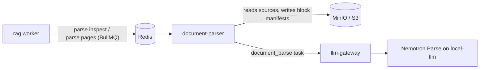

# document-parser

Queue worker that turns PDFs and images into structured, provenance-tagged content blocks.



## Key components

- `app/application` — inspect and parse-pages use cases
- `app/domain` — page classification, layout, blocks
- `app/adapters` — BullMQ, S3, PDFium, Tesseract, gateway
- `app/adapters/vendor/nemotron_parse` — vendored Nemotron post-processing
- `app/contracts/generated` — models from `rag/contracts` schemas
- `app/entrypoints` — worker and health server

## Tech stack

- Python 3.12, BullMQ (Python), redis-py
- pypdfium2, pdfminer.six, Pillow, Tesseract (eng + ben)
- boto3, httpx, Pydantic
- pytest

## Configuration

All variables use the `DOCUMENT_PARSER_` prefix; [.env.example](.env.example) documents every one.

| Variable | Description | Default |
| --- | --- | --- |
| `DOCUMENT_PARSER_REDIS_URL` | Redis holding the BullMQ queues | required |
| `DOCUMENT_PARSER_QUEUE_PREFIX` | BullMQ key prefix shared with rag | `rag` |
| `DOCUMENT_PARSER_S3_ENDPOINT` / `_S3_BUCKET` | Object storage endpoint and allowed bucket | required |
| `DOCUMENT_PARSER_LLM_GATEWAY_URL` / `_API_KEY` | llm-gateway endpoint and key | required |
| `DOCUMENT_PARSER_PARSE_PAGES_CONCURRENCY` | Parallel page-batch jobs | `1` |
| `DOCUMENT_PARSER_TESSERACT_LANGUAGES` | OCR languages | `eng+ben` |
| `DOCUMENT_PARSER_PORT` | Health port | `8090` |

## API

- Consumes BullMQ queues `parse.inspect` and `parse.pages`
- Health: `/health/live`, `/health/ready`

## Running locally

```bash
cp .env.example .env   # set the storage password and gateway key
docker compose up --build
curl http://localhost:8090/health/ready
```

Tests: `docker build --target test -t document-parser:test . && docker run --rm document-parser:test`.
