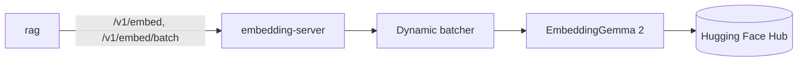

# embedding-server

HTTP service that turns text and images into EmbeddingGemma 2 vectors for retrieval.



## Key components

- `app/main.py` — FastAPI app and routes
- `app/batching.py` — cross-request dynamic batching
- `app/model.py` — model loading and inference
- `app/images.py` — safe image decoding
- `app/schemas.py` — request and response models

## Tech stack

- Python 3.12, FastAPI, Uvicorn
- PyTorch, Transformers (EmbeddingGemma 2)
- Pillow, NumPy, Pydantic
- pytest

## Configuration

All variables use the `EMBEDDING_SERVER_` prefix; [.env.example](.env.example) documents every one.

| Variable | Description | Default |
| --- | --- | --- |
| `EMBEDDING_SERVER_API_KEY` | Bearer key for callers | required |
| `EMBEDDING_SERVER_HUGGINGFACE_TOKEN` | Token for the gated model | empty |
| `EMBEDDING_SERVER_MODEL_NAME` | Model to load | `google/embeddinggemma-2` |
| `EMBEDDING_SERVER_DEVICE` | `auto`, `cpu` or `cuda` | `auto` |
| `EMBEDDING_SERVER_EMBEDDING_DIMENSION` | Output vector size | `768` |
| `EMBEDDING_SERVER_INFERENCE_BATCH_SIZE` | Items per model forward pass | `16` |
| `EMBEDDING_SERVER_MAX_BATCH_ITEMS` | Items per batch request | `64` |
| `EMBEDDING_SERVER_PORT` | HTTP port | `8000` |

## API

- Embeddings: `POST /v1/embed`, `POST /v1/embed/batch` (`task` = `query` or `document`)
- Health: `/health/live`, `/health/ready`

## Running locally

```bash
cp .env.example .env   # set the API key and Hugging Face token
docker compose up --build   # first start downloads the model
curl http://localhost:8000/health/ready
```
