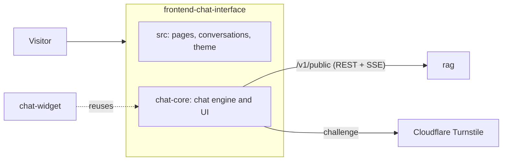

# frontend-chat-interface

Full-page end-user chat app (English and Bengali) for the platform's grounded RAG chatbot.



## Key components

- `chat-core/api` — API contract, visitor session, SSE stream
- `chat-core/features` — thread, composer, citations, message batching
- `src/features` — conversations, header, shortcuts, theme
- `src/i18n` — English and Bengali strings
- `docker/` — nginx config and runtime config script

## Sending

- Messages sent within a short random pause (1–2 s, restarted by typing) go out together as one turn.
- While a reply is on its way, the composer offers only **Stop**. Stopping cancels the turn on the
  server; the question stays in the conversation and is part of the next turn's history.
- The input enforces the admin's message length limit (`/config.limits.maxMessageChars`, 700
  characters by default) and the server checks it again.

## Tech stack

- TypeScript, React 19, Vite
- Zustand, Zod, i18next, Radix UI
- react-markdown with KaTeX and highlight.js
- nginx (unprivileged) in Docker
- Vitest, Playwright

## Configuration

[.env.example](.env.example) documents every variable.

| Variable                                   | Description                            | Default                 |
| ------------------------------------------ | -------------------------------------- | ----------------------- |
| `VITE_CHAT_API_BASE_URL`                   | Origin of rag's public API             | same origin             |
| `VITE_CHAT_BOT_NAME` / `_BRAND_ACCENT`     | Branding until `/config` loads         | `Assistant` / `#6d5dfc` |
| `VITE_CHAT_BATCH_QUIET_MIN_MS` / `_MAX_MS` | Message batching quiet window          | `1000` / `2000`         |
| `VITE_CHAT_DEFAULT_LANGUAGE`               | `en` or `bn`                           | `en`                    |
| `CHAT_DEV_RAG_API_URL`                     | rag API proxied by `npm run dev`       | `http://localhost:8080` |
| `CHAT_RUNTIME_API_BASE_URL`                | Docker: API origin written at start-up | unset                   |
| `CHAT_RUNTIME_CSP_CONNECT_SRC`             | Docker: CSP origins for API calls      | `https:`                |

## API

Static site; it calls rag's public chat API. The container serves `/healthz`.

## Running locally

```bash
npm ci
cp .env.example .env
npm run dev   # http://localhost:5190, proxies /v1 to rag
```

Checks: `npm run check`; Docker: `docker build -t frontend-chat-interface .`
