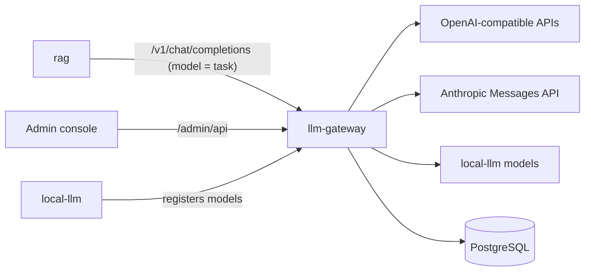

# llm-gateway

OpenAI-compatible gateway that routes each task name to an ordered chain of models across providers.



## Key components

- `app/api` — inference, tasks, admin routes
- `app/inference` — model chain execution and retries
- `app/routing` — task routes, circuit breaker; tasks are a fixed list seeded by migrations
- `app/protocols` — OpenAI, Responses, Anthropic adapters
- `app/metrics` — request metrics and cost
- `app/persistence` — SQLAlchemy tables, repositories
- `migrations/` — Alembic schema migrations

## Tech stack

- Python 3.12, FastAPI, Uvicorn
- SQLAlchemy (asyncpg) and Alembic on PostgreSQL
- httpx, Pydantic, cryptography (Fernet)
- pytest

## Configuration

All variables use the `LLM_GATEWAY_` prefix; [.env.example](.env.example) documents every one.

| Variable | Description | Default |
| --- | --- | --- |
| `LLM_GATEWAY_API_KEY` | Bearer key for inference callers | required |
| `LLM_GATEWAY_REGISTRATION_API_KEY` | Key local-llm uses to register models | required |
| `LLM_GATEWAY_ADMIN_API_KEY` | Bearer key for the admin console backend | empty |
| `LLM_GATEWAY_ENCRYPTION_KEY` | Fernet key encrypting provider secrets | required |
| `LLM_GATEWAY_ADMIN_SESSION_SECRET` | Admin session signing secret | required |
| `LLM_GATEWAY_DATABASE_URL` | PostgreSQL URL (`postgresql+asyncpg://…`; add `?ssl=require` for Neon) | required |
| `LLM_GATEWAY_PORT` | HTTP port | `4000` |
| `LLM_GATEWAY_MAX_ATTEMPTS_PER_MODEL` | Retries per model before moving down the chain | `3` |
| `LLM_GATEWAY_METRICS_RETENTION_DAYS` | Request metrics retention | `180` |

## API

- Inference (`/v1`): chat completions, models, task limits
- Local models (`/v1/local-models`): registration from local-llm
- Admin (`/admin/api`): providers, models, task list (read-only), chains, circuit breakers, analytics, settings
- Health: `/health/live`, `/health/ready`

## Running locally

```bash
cp .env.example .env   # set every secret
docker compose up --build
curl http://localhost:4000/health/ready
```

For development: `pip install -r requirements-dev.txt`, then `pytest`, `ruff check .` and `mypy app`.
