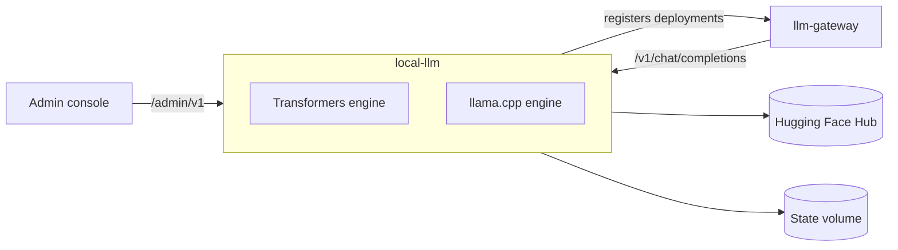

# local-llm

Self-hosted model server that runs Nemotron Parse and admin-deployed models on CPU or NVIDIA GPU.



## Key components

- `app/deployments` — deployment lifecycle and persistence
- `app/engines` — Transformers and llama.cpp backends
- `app/admission.py` — memory-based admission control
- `app/hardware.py` — CPU, RAM, GPU detection
- `app/gateway_registration.py` — syncs deployments to llm-gateway
- `app/routes` — inference, admin, health routes

## Tech stack

- Python 3.12, FastAPI, Uvicorn
- PyTorch, Transformers, llama.cpp (`llama-server`)
- huggingface_hub, Pydantic, httpx
- pytest

## Configuration

All variables use the `LOCAL_LLM_` prefix; [.env.example](.env.example) documents every one.

| Variable | Description | Default |
| --- | --- | --- |
| `LOCAL_LLM_INFERENCE_API_KEY` | Bearer key for `/v1` callers | required |
| `LOCAL_LLM_ADMIN_API_KEY` | Bearer key for `/admin/v1` | required |
| `LOCAL_LLM_HUGGINGFACE_TOKEN` | Token for gated models | empty |
| `LOCAL_LLM_SYSTEM_MODEL_ID` | Always-on parser model | `nvidia/Nemotron-3.5-Parse` |
| `LOCAL_LLM_SYSTEM_DEVICE` | `auto`, `cpu` or `cuda` | `auto` |
| `LOCAL_LLM_STATE_DIRECTORY` | Model cache and deployment state | `/var/lib/local-llm` |
| `LOCAL_LLM_GATEWAY_BASE_URL` | Gateway to register with; blank disables | `http://llm-gateway:4000` |
| `LOCAL_LLM_GATEWAY_REGISTRATION_API_KEY` | Gateway registration key | empty |
| `LOCAL_LLM_PUBLIC_BASE_URL` | URL the gateway uses to reach this service | `http://local-llm:8000` |

## API

- Inference (`/v1`): OpenAI-compatible chat completions, models
- Admin (`/admin/v1`): system resources, deployments (create, update, load, unload, restart, delete)
- Health: `/health/live`, `/health/ready`

## Running locally

```bash
cp .env.example .env   # set every secret
docker compose up --build   # first start downloads Nemotron Parse (~2.5 GB)
curl http://localhost:8095/health/ready
```

For a GPU image: `docker build --build-arg INFERENCE_DEVICE=cuda -t local-llm:cuda .`
