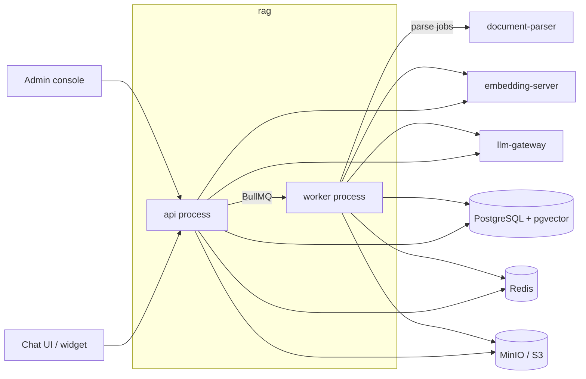

# rag

Core RAG backend: document ingestion, hybrid retrieval, grounded chat with citations, and the admin API.



## Key components

- `src/modules/chat` — public chat, turns, memory
- `src/modules/ingestion` — upload-to-index pipeline
- `src/modules/retrieval` — hybrid search: pgvector embeddings + Postgres full-text
- `src/modules/**/*-admin.controller.ts` — admin API controllers
- `src/domain` — pure chunking, ranking, prompt logic
- `src/infrastructure` — S3, Redis, HTTP adapters
- `contracts/` — JSON Schemas shared with the parser

## Tech stack

- TypeScript, Node.js 24, NestJS 12
- Drizzle ORM on PostgreSQL with pgvector (chunks, vectors and full-text search in one database)
- BullMQ on Redis, S3-compatible storage
- Pino, Vitest

## Configuration

All variables use the `RAG_` prefix; [.env.example](.env.example) documents every one.

| Variable                                | Description                                 | Default  |
| --------------------------------------- | ------------------------------------------- | -------- |
| `RAG_DATABASE_URL`                      | PostgreSQL URL with pgvector (Neon: direct) | required |
| `RAG_REDIS_URL`                         | Redis connection URL                        | required |
| `RAG_S3_ENDPOINT` / `RAG_S3_BUCKET`     | Object storage endpoint and bucket          | required |
| `RAG_EMBEDDING_SERVER_URL` / `_API_KEY` | embedding-server endpoint and key           | required |
| `RAG_LLM_GATEWAY_URL` / `_API_KEY`      | llm-gateway endpoint and key                | required |
| `RAG_ADMIN_API_KEY`                     | Bearer key for the admin console backend    | empty    |
| `RAG_CLIENT_HASH_SECRET`                | HMAC key for visitor IPs and fingerprints   | required |
| `RAG_PUBLIC_CORS_ALLOWED_ORIGINS`       | Origins allowed to call the public API      | empty    |
| `RAG_PORT`                              | HTTP port                                   | `8080`   |
| `RAG_WORKER_CONCURRENCY`                | Parallel jobs per queue                     | `2`      |

## API

- Public chat (`/v1/public`): visitor sessions, conversations, streamed turns, feedback
- Admin (`/v1/admin`): documents, settings, index versions, analytics, widget keys, audit
- Health: `/health/live`, `/health/ready`
- OpenAPI: `/docs` and `/openapi.json` when `RAG_ENABLE_API_DOCS=true`

## Running locally

```bash
cp .env.example .env   # set every secret
docker compose up --build -d --wait
curl http://localhost:8080/health/ready
```

For development: `npm ci`, then `npm test`, `npm run lint` and `npm run typecheck`.
